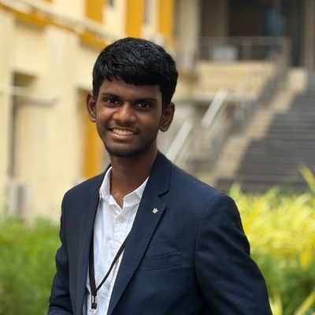
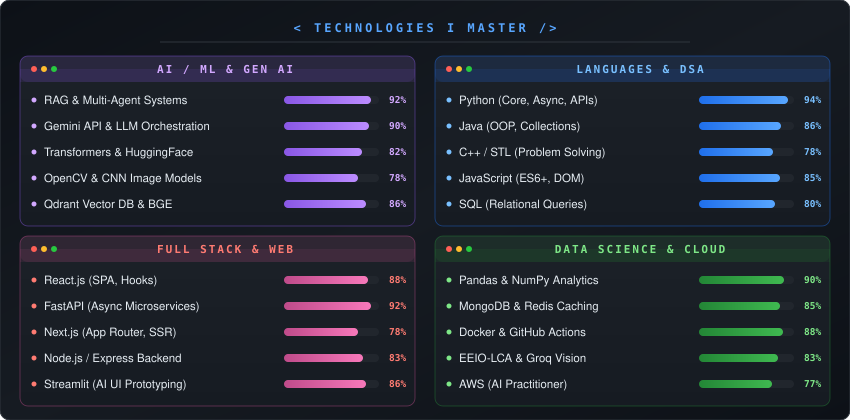

  

&nbsp;

&nbsp;

&nbsp;

 

---

### 👨‍💻 About Me

<table>
  <tr>
    <td width="22%" align="center" valign="middle">
      
       
      <b>Vijayaramanujam N</b>
       
      Chennai, India
    </td>
    <td width="78%" valign="top">
      
I am a <b>Computer Science Engineering student</b> at <b>Chennai Institute of Technology</b> (CGPA: <b>9.52 / 10</b>) and an <b>Aspiring AI Developer</b> passionate about engineering high-performance AI systems, multi-agent frameworks, and scalable cloud architectures.

      <ul>
        <li>🔭 <b>Currently Building:</b> Enterprise Agentic AI platforms and automated carbon accounting tools.</li>
        <li>🧠 <b>Core Focus:</b> RAG Pipelines, LLM Orchestration, Vector Search & Full-Stack Systems.</li>
        <li>🏆 <b>Hackathons:</b> 1st Runner-Up at <i>One Earth International Hackathon</i> (among 5,000+ teams worldwide).</li>
        <li>⚡ <b>Competitive Programming:</b> Solved <b>564+ problems on LeetCode</b> (Peak Rating: <b>1738</b>) and <b>200+ on CodeChef</b>.</li>
        <li>🎙️ <b>Leadership:</b> Chief Communication Officer at <i>Asymmetric Club</i>; writer on Medium & host of tech podcasts on Spotify.</li>
      </ul>
    </td>
  </tr>
</table>

---

### 📊 Skills & Proficiency Breakdown

  

 

### 🛠️ Technical Stack & Frameworks

<table>
  <tr>
    <td width="20%"><b>Core Languages</b></td>
    <td>
      
      
      
      
      
    </td>
  </tr>
  <tr>
    <td><b>AI & Machine Learning</b></td>
    <td>
      
      
      
      
      
      
      
    </td>
  </tr>
  <tr>
    <td><b>Web & Frameworks</b></td>
    <td>
      
      
      
      
      
    </td>
  </tr>
  <tr>
    <td><b>Databases & Cloud</b></td>
    <td>
      
      
      
      
      
    </td>
  </tr>
  <tr>
    <td><b>Data Science & Tools</b></td>
    <td>
      
      
      
      
      
      
    </td>
  </tr>
</table>

---

### 🚀 Featured Engineering Projects

<table>
  <tr>
    <td width="50%" valign="top">
      <h3>🌍 <a href="https://github.com/Vijayaramanujam">CarbonIQ</a></h3>
      
<b>AI-Powered Carbon Accounting & Decarbonization Platform</b>

      <ul>
        <li>Automates SME carbon accounting across Scope 1, 2, and 3 emissions.</li>
        <li>Groq Vision extraction for invoice processing with 149 CEA 2024 emission factors.</li>
        <li>EEIO-based emission hotspot modeling & reduction roadmaps.</li>
      </ul>
      
<code>Python</code> <code>FastAPI</code> <code>React.js</code> <code>Groq Vision</code> <code>EEIO-LCA</code>

    </td>
    <td width="50%" valign="top">
      <h3>🏥 <a href="https://github.com/Vijayaramanujam">Agentic Medical Analyser</a></h3>
      
<b>Multi-Agent AI Healthcare Diagnostic Platform</b>

      <ul>
        <li>Multi-agent platform for intelligent symptom assessment and medical report parsing.</li>
        <li>Context-aware RAG pipelines using transformer models with FastAPI backend.</li>
        <li>Automates clinical evidence synthesis, risk stratification, and patient insights.</li>
      </ul>
      
<code>Python</code> <code>FastAPI</code> <code>Transformers</code> <code>NLP</code> <code>RAG</code>

    </td>
  </tr>
  <tr>
    <td width="50%" valign="top">
      <h3>📊 <a href="https://github.com/Vijayaramanujam">Business Analyst Agent</a></h3>
      
<b>Enterprise AI Business Analysis Engine</b>

      <ul>
        <li>Generates end-to-end BRDs, use case specifications, and Gantt charts from prompts.</li>
        <li>Leverages Google Agent Development Kit (ADK) & Gemini LLM APIs.</li>
        <li>Interactive dashboard reducing strategic planning time by over 70%.</li>
      </ul>
      
<code>Python</code> <code>Google ADK</code> <code>Gemini</code> <code>Streamlit</code>

    </td>
    <td width="50%" valign="top">
      <h3>🔍 <a href="https://github.com/Vijayaramanujam">Industrial Vision QC</a></h3>
      
<b>Defect Detection System @ SmartScope Automation</b>

      <ul>
        <li>Computer vision defect identification pipeline on industrial product imagery.</li>
        <li>Dataset preprocessing, geometric augmentation, and CNN model training.</li>
        <li>Supported automated quality inspection and production-line verification.</li>
      </ul>
      
<code>Python</code> <code>OpenCV</code> <code>CNN</code> <code>Deep Learning</code>

    </td>
  </tr>
</table>

---

### 🏆 Honors & Key Achievements

| Award / Recognition | Event / Organization | Impact / Standing |
|:---|:---|:---|
| 🥈 **1st Runner-Up** | **One Earth International Hackathon** | Ranked 2nd globally out of **5,000+ teams** |
| 🎨 **Best UI/UX Award** | **HackOrbital 2026** (Indian Institute of Space Science and Technology) | Selected among **75 teams across India** |
| 🏅 **Runner-Up** | **Pragyan AI Hackathon 2026** (NIT Trichy) | National-level AI innovation competition |
| 💻 **564+ Problems Solved** | **LeetCode** | Peak Contest Rating: **1738** |
| ⚡ **200+ Problems Solved** | **CodeChef** | Rating: **1356** (1★ Coder) |
| 📜 **Certifications** | **AWS & Cisco** | AWS Certified AI Practitioner *(In Progress)* · Cisco Essentials in Python |

---

### 📈 GitHub Analytics

<table border="0">
  <tr>
    <td>
      
    </td>
    <td>
      
    </td>
  </tr>
</table>

 

  

---

### 📬 Get In Touch

  
I am actively seeking software engineering internships, AI research roles, and collaborative open-source projects.

  
  &nbsp;
  
  &nbsp;
  

 

  © 2026 Vijayaramanujam N · Chennai Institute of Technology

