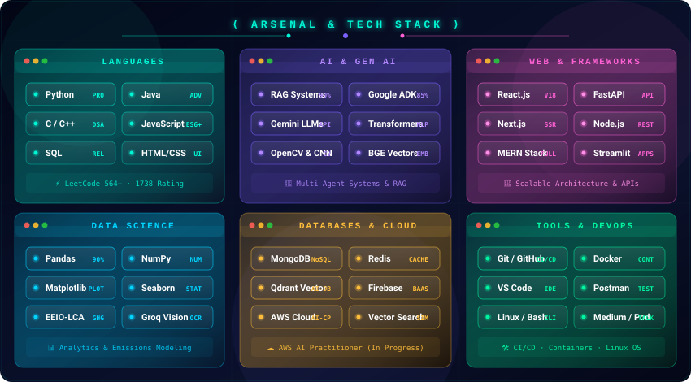

<!-- ╔══════════════════════════════════════════════════════════════════════╗ -->
<!-- ║           VIJAYARAMANUJAM — GitHub Profile README                    ║ -->
<!-- ║           Theme: Cyberpunk Neural · Cyan / Purple / Pink             ║ -->
<!-- ╚══════════════════════════════════════════════════════════════════════╝ -->

<div align="center">

<!-- ═══════════════════════ HERO BANNER ═══════════════════════ -->


<br/>

<!-- Visitor counter -->

&nbsp;

&nbsp;


</div>

<br/>

<!-- ═══════════════════════ ABOUT ME ═══════════════════════ -->

<div align="center">

```
 ~/about $ cat bio.md
```

</div>

<br/>

<table>
<tr>
<td width="55%">

> I build **AI-powered platforms** and **full-stack applications** that solve real-world problems —
> from multi-agent healthcare systems to carbon accounting tools. Currently pursuing my B.E. in
> Computer Science at **Chennai Institute of Technology** (CGPA: **9.52/10**), I'm driven by the
> intersection of **machine learning, LLMs, and scalable web architectures.**
>
> When I'm not coding, I'm competing in hackathons, writing tech articles on **Medium**, hosting
> tech podcasts on **Spotify**, or pushing my **LeetCode** streak past **564+** problems.

</td>
<td width="45%">

```js
const vijayaramanujam = {
  role: "CS Student & AI Developer",
  location: "Chennai, India",
  education: "CIT • CGPA 9.52",
  currentFocus: [
    "Multi-Agent AI Systems",
    "RAG Pipelines & LLMs",
    "Full-Stack Development",
  ],
  funFact: "1st Runner-Up among 5000+ teams 🏆",
  motto: "Ship fast. Learn faster."
};
```

</td>
</tr>
</table>

<br/>

<!-- ═══════════════════════ TECH STACK & RADAR ═══════════════════════ -->

<div align="center">



</div>

<br/>

<!-- ═══════════════════════ 3D STATS & ACHIEVEMENTS ═══════════════════════ -->

<div align="center">



</div>

<br/>

<!-- ═══════════════════════ FEATURED PROJECTS ═══════════════════════ -->

<details open>
<summary><h2>🚀 &nbsp; Featured Projects</h2></summary>
<br/>

<table>
<tr>
<td width="50%" valign="top">

### 🌍 CarbonIQ
**AI-Powered Carbon Accounting & Decarbonization**

   

- Automates SME carbon accounting across all 3 GHG scopes
- Groq Vision invoice extraction + 149 CEA emission factors
- EEIO-based estimation & decarbonization planner

</td>
<td width="50%" valign="top">

### 🏥 Agentic Medical Analyser
**Multi-Agent AI Healthcare System**

   

- Intelligent symptom analysis & medical report interpretation
- LLMs + transformer NLP + RAG pipelines
- Automated risk assessment & decision support

</td>
</tr>
<tr>
<td width="50%" valign="top">

### 📊 Business Analyst Agent
**Enterprise AI Automation**

  

- Auto-generates BRDs, use cases, Gantt charts from NL inputs
- Multi-agent platform for business analysis workflows
- Streamlines enterprise decision-making

</td>
<td width="50%" valign="top">

### 🔍 Industrial Defect Detection
**Computer Vision QC @ SmartScope**

  

- Identifies defects in industrial product images
- Dataset collection, preprocessing & augmentation pipeline
- Automated quality inspection with documented outcomes

</td>
</tr>
</table>

</details>

<br/>

<!-- ═══════════════════════ GITHUB STATS ═══════════════════════ -->

<div align="center">

<h2>📈 GitHub Analytics</h2>

<br/>

<!-- Stats + Streak side by side -->
<picture>
  <source media="(prefers-color-scheme: dark)" srcset="https://github-readme-stats.vercel.app/api?username=Vijayaramanujam&show_icons=true&hide_border=true&title_color=00f5d4&icon_color=7b61ff&text_color=c9d1d9&bg_color=0d1117&ring_color=ff61d4"/>
  
</picture>
&nbsp;&nbsp;
<picture>
  <source media="(prefers-color-scheme: dark)" srcset="https://github-readme-streak-stats.herokuapp.com?user=Vijayaramanujam&hide_border=true&ring=00f5d4&fire=ff61d4&currStreakLabel=00f5d4&sideLabels=c9d1d9&dates=8b949e&background=0d1117&currStreakNum=7b61ff&sideNums=00f5d4"/>
  
</picture>

<br/><br/>

<!-- Top Languages -->
<picture>
  <source media="(prefers-color-scheme: dark)" srcset="https://github-readme-stats.vercel.app/api/top-langs/?username=Vijayaramanujam&layout=compact&hide_border=true&title_color=00f5d4&text_color=c9d1d9&bg_color=0d1117&langs_count=10"/>
  
</picture>

<br/><br/>

<!-- GitHub Trophies -->


<br/><br/>

<!-- Activity Graph -->


<br/><br/>

<!-- Snake Contribution (auto-generated) -->
<picture>
  <source media="(prefers-color-scheme: dark)" srcset="assets/github-snake.svg"/>
  
</picture>

<br/><br/>

<!-- 3D Contribution Graph (auto-generated) -->


<br/><br/>

<!-- Metrics (auto-generated) -->


</div>

<br/>

<!-- ═══════════════════════ CONNECT ═══════════════════════ -->

<div align="center">

```
 ~/connect $ echo "Let's build something amazing together"
```

<br/>

<a href="mailto:vrn05nujan@gmail.com">
  
</a>
&nbsp;
<a href="https://linkedin.com/in/vijayaramanujam05">
  
</a>
&nbsp;
<a href="https://github.com/Vijayaramanujam">
  
</a>

</div>

<br/>

<!-- ═══════════════════════ FOOTER ═══════════════════════ -->

<div align="center">



<br/><br/>

<sub>⚡ Crafted with custom animated SVGs, 3D isometric charts, and automated GitHub Actions</sub>
<br/>
<sub>🔄 Stats auto-update every 24 hours via CI/CD pipeline</sub>

</div>
