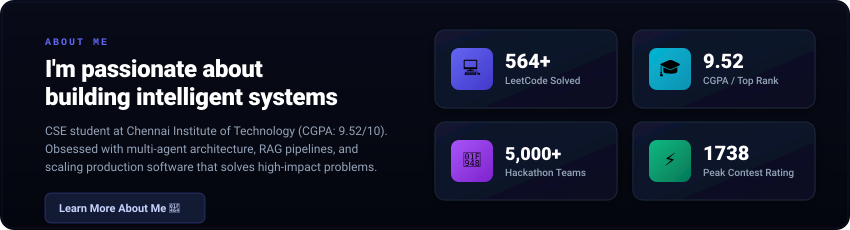

<!-- ╔══════════════════════════════════════════════════════════════════════╗ -->
<!-- ║         VIJAYARAMANUJAM — Elite AI & Software Engineering Profile    ║ -->
<!-- ║         Theme: CodeCraft Luxury Dark / 3D Three.js Aesthetic        ║ -->
<!-- ╚══════════════════════════════════════════════════════════════════════╝ -->

<div align="center">

<!-- ═══════════════════════ CODECRAFT LUXURY HERO BANNER ═══════════════════════ -->


<br/><br/>

<!-- ═══════════════════════ ABOUT ME & STATS OVERVIEW ═══════════════════════ -->


<br/><br/>

<!-- ═══════════════════════ TECHNOLOGIES I MASTER ═══════════════════════ -->


<br/><br/>

<!-- ═══════════════════════ 3D ISOMETRIC AWARDS & TROPHIES ═══════════════════════ -->


</div>

<br/>

<!-- ═══════════════════════ FEATURED PROJECTS (CodeCraft 3-Card Portfolio) ═══════════════════════ -->

<div align="center">
  <sub>FEATURED PROJECTS</sub>
  <h2>Some of My Recent Work</h2>
</div>

<br/>

<table>
<tr>
<td width="33.3%" valign="top">

```
01 // SUSTAINABILITY AI
```

### 🌍 CarbonIQ
**Automated Carbon Accounting Platform**

> AI-powered platform automating SME carbon accounting across all 3 GHG scopes with Groq Vision OCR & 149 CEA emission factors.

<br/>

`Python` `FastAPI` `React.js` `Groq`

<br/>

[View Project →](https://github.com/Vijayaramanujam)

</td>
<td width="33.3%" valign="top">

```
02 // HEALTHCARE AI
```

### 🏥 Agentic Medical Analyser
**Multi-Agent Clinical Intelligence**

> Context-aware clinical report analysis & symptom risk assessment driven by LLMs, transformer NLP, and modular RAG workflows.

<br/>

`Transformers` `RAG` `FastAPI` `LLMs`

<br/>

[View Project →](https://github.com/Vijayaramanujam)

</td>
<td width="33.3%" valign="top">

```
03 // ENTERPRISE AGENTS
```

### 📊 Business Analyst Agent
**Enterprise Workflow Automation**

> Auto-generates BRDs, user stories, and Gantt charts from plain English using Google Agent Development Kit & Gemini API.

<br/>

`Google ADK` `Gemini` `Streamlit`

<br/>

[View Project →](https://github.com/Vijayaramanujam)

</td>
</tr>
</table>

<br/>

<!-- ═══════════════════════ GITHUB VELOCITY & ANALYTICS ═══════════════════════ -->

<div align="center">

<!-- GitHub Stats + Streak Cards -->
<picture>
  <source media="(prefers-color-scheme: dark)" srcset="https://github-readme-stats.vercel.app/api?username=Vijayaramanujam&show_icons=true&hide_border=true&title_color=6366f1&icon_color=a855f7&text_color=94a3b8&bg_color=0a0d1e&ring_color=38bdf8"/>
  
</picture>
&nbsp;&nbsp;
<picture>
  <source media="(prefers-color-scheme: dark)" srcset="https://github-readme-streak-stats.herokuapp.com?user=Vijayaramanujam&hide_border=true&ring=6366f1&fire=a855f7&currStreakLabel=38bdf8&sideLabels=94a3b8&dates=64748b&background=0a0d1e&currStreakNum=6366f1&sideNums=38bdf8"/>
  
</picture>

<br/><br/>

<!-- Contribution Activity Graph -->


<br/><br/>

<!-- GitHub Trophies -->


</div>

<br/>

<!-- ═══════════════════════ LET'S WORK TOGETHER (Exact CodeCraft Footer) ═══════════════════════ -->

<div align="center">

<table width="850">
<tr>
<td width="40%" valign="top">

<sub>LET'S WORK TOGETHER</sub>
### Have a project or internship in mind?
I'm always open to discussing new AI projects, research, and high-impact engineering opportunities!

<br/>

<a href="mailto:vrn05nujan@gmail.com">
  
</a>

</td>
<td width="35%" valign="top">

```
“ Vijay is a high-velocity engineer 
  who delivers robust AI systems with 
  remarkable attention to detail. ”
```

<sub>— Hackathon Judge &amp; Club Collaborators</sub>

</td>
<td width="25%" valign="top">

<sub>FOLLOW ME</sub><br/>

<a href="https://github.com/Vijayaramanujam">
  
</a><br/>
<a href="https://linkedin.com/in/vijayaramanujam05">
  
</a><br/>
<a href="mailto:vrn05nujan@gmail.com">
  
</a><br/>
<a href="https://leetcode.com/u/Vijayaramanujam/">
  
</a>

</td>
</tr>
</table>

<br/>

<sub>© 2026 Vijayaramanujam · Made with 💜 for AI Engineering · Chennai Institute of Technology</sub>

</div>
