<!-- ╔══════════════════════════════════════════════════════════════════╗ -->
<!-- ║              VIJAYARAMANUJAM — GitHub Profile README             ║ -->
<!-- ╚══════════════════════════════════════════════════════════════════╝ -->

<div align="center">

<!-- Hero Banner -->


</div>

<!-- ─────────────────────────────── About ─────────────────────────────── -->

<br/>

```
 ~/about $ cat bio.md
```

> I build **AI-powered platforms** and **full-stack applications** that solve real-world problems — from
> multi-agent healthcare systems to carbon accounting tools. Currently pursuing my B.E. in Computer Science
> at **Chennai Institute of Technology** (CGPA: 9.52), I'm driven by the intersection of **machine learning,
> LLMs, and scalable web architectures.** When I'm not coding, I'm competing in hackathons, writing tech
> articles on Medium, or pushing my LeetCode streak past 564+ problems.

<br/>

<!-- ───────────────────────── Tech Stack ────────────────────────── -->

<div align="center">



</div>

<br/>

<!-- ───────────────────── Featured Projects ─────────────────────── -->

<details>
<summary><b>🚀 &nbsp; Featured Projects</b></summary>
<br/>

<table>
<tr>
<td width="50%">

### 🌍 CarbonIQ
**AI-Powered Carbon Accounting & Decarbonization**
  
`Python` `React.js` `FastAPI` `Groq Vision` `Pandas`

- Automates SME carbon accounting across all 3 GHG scopes
- Groq Vision invoice extraction + 149 CEA 2024 emission factors
- EEIO-based emissions estimation & decarbonization planner

</td>
<td width="50%">

### 🏥 Agentic Medical Analyser
**Multi-Agent AI Healthcare System**

`Python` `React.js` `FastAPI` `Transformers` `RAG`

- Intelligent symptom analysis & medical report interpretation
- LLMs + transformer NLP + RAG pipelines
- Automated clinical information synthesis & risk assessment

</td>
</tr>
<tr>
<td width="50%">

### 📊 Business Analyst Agent
**Enterprise AI Automation**

`Python` `Google ADK` `Gemini` `Streamlit`

- Auto-generates BRDs, use cases, Gantt charts from NL inputs
- Multi-agent AI platform for business analysis workflows
- Leverages Google ADK + Gemini for enterprise decisions

</td>
<td width="50%">

### 🔍 Computer Vision QC
**Industrial Defect Detection @ SmartScope**

`Python` `OpenCV` `CNN` `Deep Learning`

- Identifies defects in industrial product images
- Dataset collection, preprocessing, augmentation pipeline
- Automated quality inspection with documented outcomes

</td>
</tr>
</table>

</details>

<br/>

<!-- ───────────────────── Achievements ─────────────────────── -->

<details>
<summary><b>🏆 &nbsp; Achievements & Competitive Programming</b></summary>
<br/>

| 🥇 Achievement | 📍 Event |
|---|---|
| **1st Runner-Up** | One Earth International Hackathon — *5,000+ teams worldwide* |
| **Best UI/UX Award** | HackOrbital 2026, IIST — *75 teams across India* |
| **Runner-Up** | Pragyan AI Hackathon 2026, NIT Trichy |

<br/>

| 💻 Platform | 📈 Stats |
|---|---|
| **LeetCode** | 564+ Problems Solved · Peak Rating: **1738** |
| **CodeChef** | 200+ Problems · Rating: **1356** |

</details>

<br/>

<!-- ────────────────── GitHub Metrics (auto-updated) ──────────────────── -->

<div align="center">

### 📊 GitHub Metrics

<!-- Auto-generated by .github/workflows/metrics.yml -->


<br/>

<!-- 3D Contribution Graph -->


</div>

<br/>

<!-- ──────────────────────── GitHub Stats ─────────────────────────── -->

<div align="center">

<picture>
  <source media="(prefers-color-scheme: dark)" srcset="https://github-readme-stats.vercel.app/api?username=Vijayaramanujam&show_icons=true&theme=transparent&hide_border=true&title_color=00f5d4&icon_color=7b61ff&text_color=c9d1d9&bg_color=0d1117"/>
  
</picture>
&nbsp;&nbsp;
<picture>
  <source media="(prefers-color-scheme: dark)" srcset="https://github-readme-streak-stats.herokuapp.com?user=Vijayaramanujam&theme=transparent&hide_border=true&ring=00f5d4&fire=7b61ff&currStreakLabel=00f5d4&sideLabels=c9d1d9&dates=8b949e&background=0d1117"/>
  
</picture>

</div>

<br/>

<!-- ───────────────────────── Connect ─────────────────────────── -->

<div align="center">

```
 ~/connect $ echo "Let's build something amazing together"
```

<br/>

<a href="mailto:vrn05nujan@gmail.com">
  
</a>
&nbsp;&nbsp;
<a href="https://linkedin.com/in/vijayaramanujam05">
  
</a>
&nbsp;&nbsp;
<a href="https://github.com/Vijayaramanujam">
  
</a>

</div>

<br/>

<!-- Footer Banner -->
<div align="center">


</div>

<!-- ─────────────────────────────────────────────────────────────────── -->

<div align="center">
<sub>⚡ Built with custom SVGs and automated GitHub Actions • Last updated: November 2026</sub>
</div>
