<!-- ╔══════════════════════════════════════════════════════════════════════╗ -->
<!-- ║         VIJAYARAMANUJAM — Elite AI & Software Engineering Profile    ║ -->
<!-- ║         Dark Cyberpunk · 3D Interactive Design · Ultra High-Impact   ║ -->
<!-- ╚══════════════════════════════════════════════════════════════════════╝ -->

<div align="center">

<!-- ═══════════════════════ 3D CYBERNETIC HERO BANNER ═══════════════════════ -->


<br/><br/>

<!-- Profile Badges & Stats -->
<a href="https://github.com/Vijayaramanujam">
  
</a>
&nbsp;
<a href="https://github.com/Vijayaramanujam?tab=followers">
  
</a>
&nbsp;
<a href="https://github.com/Vijayaramanujam?tab=repositories">
  
</a>
&nbsp;
<a href="https://leetcode.com/u/Vijayaramanujam/">
  
</a>

</div>

<br/>

<!-- ═══════════════════════ WHO I AM & MISSION ═══════════════════════ -->

<div align="center">

```
 ~/vijayaramanujam $ cat executive-summary.json
```

</div>

<br/>

<table>
<tr>
<td width="58%" valign="top">

### 💡 Executive Bio
I build **agentic AI platforms**, **scalable cloud APIs**, and **intelligent automation engines** that tackle real-world complexity — from enterprise carbon accounting across all 3 GHG scopes to multi-agent clinical diagnostic systems. 

- 🎓 **Education:** B.E. in Computer Science Engineering at **Chennai Institute of Technology** (**CGPA: 9.52 / 10**)
- 🧠 **Primary Focus:** Multi-Agent Systems, RAG Pipelines, Vector Search & High-Performance Backends
- ⚡ **Competitive Edge:** Solved **564+ LeetCode problems** (*Peak Rating: 1738*) & **200+ CodeChef challenges**
- 🎙️ **Community:** Chief Communication Officer at *Asymmetric Club*, tech writer on Medium & Spotify podcast host

</td>
<td width="42%" valign="top">

```json
{
  "engineer": "Vijayaramanujam N",
  "role": "Aspiring AI Developer",
  "location": "Chennai, India",
  "academicStanding": "CGPA 9.52 / 10",
  "achievements": [
    "🥈 1st Runner-Up · One Earth Hackathon (5000+ teams)",
    "🏆 Best UI/UX · HackOrbital IIST (75 teams)",
    "🥈 Runner-Up · Pragyan AI Hackathon NIT Trichy"
  ],
  "philosophy": "Ship fast. Learn faster. Break nothing."
}
```

</td>
</tr>
</table>

<br/>

<!-- ═══════════════════════ TECHNOLOGIES I MASTER ═══════════════════════ -->

<div align="center">


</div>

<br/>

<!-- ═══════════════════════ 3D ISOMETRIC STATS & TROPHIES ═══════════════════════ -->

<div align="center">


</div>

<br/>

<!-- ═══════════════════════ FEATURED PROJECTS ═══════════════════════ -->

<details open>
<summary><h2>🚀 &nbsp; Flagship Engineering Projects</h2></summary>
<br/>

<table>
<tr>
<td width="50%" valign="top">

### 🌍 CarbonIQ
**AI Carbon Accounting & Decarbonization Platform (2026)**

   

- Automates SME carbon accounting across all 3 GHG scopes
- Groq Vision invoice OCR + 149 CEA 2024 emission factors
- EEIO-based emissions estimation & decarbonization planner

</td>
<td width="50%" valign="top">

### 🏥 Agentic Medical Analyser
**Multi-Agent AI Healthcare Platform (2025)**

   

- Context-aware symptom interpretation & clinical report analysis
- LLMs + transformer-based NLP + modular RAG pipelines
- Automated risk assessment & healthcare decision support

</td>
</tr>
<tr>
<td width="50%" valign="top">

### 📊 Business Analyst Agent
**Enterprise AI Automation (2026)**

  

- Auto-generates BRDs, use cases, Gantt charts from natural language
- Multi-agent AI platform streamlining corporate business planning
- Integrated Google Agent Development Kit (ADK) + Gemini models

</td>
<td width="50%" valign="top">

### 🔍 Computer Vision QC System
**Industrial Defect Detection @ SmartScope Automation**

  

- Automated vision pipeline for defect classification on production lines
- Dataset collection, augmentation & CNN hyperparameter optimization
- Quality assurance reporting with documented outcomes

</td>
</tr>
</table>

</details>

<br/>

<!-- ═══════════════════════ GITHUB ANALYTICS & ACTIVITY ═══════════════════════ -->

<div align="center">

<h2>📈 Real-Time Engineering Velocity</h2>

<br/>

<!-- Stats + Streak side by side -->
<picture>
  <source media="(prefers-color-scheme: dark)" srcset="https://github-readme-stats.vercel.app/api?username=Vijayaramanujam&show_icons=true&hide_border=true&title_color=00f5d4&icon_color=7b61ff&text_color=c9d1d9&bg_color=0d1117&ring_color=ff61d4"/>
  
</picture>
&nbsp;&nbsp;
<picture>
  <source media="(prefers-color-scheme: dark)" srcset="https://github-readme-streak-stats.herokuapp.com?user=Vijayaramanujam&hide_border=true&ring=00f5d4&fire=ff61d4&currStreakLabel=00f5d4&sideLabels=c9d1d9&dates=8b949e&background=0d1117&currStreakNum=7b61ff&sideNums=00f5d4"/>
  
</picture>

<br/><br/>

<!-- Top Languages -->
<picture>
  <source media="(prefers-color-scheme: dark)" srcset="https://github-readme-stats.vercel.app/api/top-langs/?username=Vijayaramanujam&layout=compact&hide_border=true&title_color=00f5d4&text_color=c9d1d9&bg_color=0d1117&langs_count=10"/>
  
</picture>

<br/><br/>

<!-- GitHub Trophies -->


<br/><br/>

<!-- Contribution Activity Graph -->


</div>

<br/>

<!-- ═══════════════════════ CONNECT & COLLABORATE ═══════════════════════ -->

<div align="center">

```
 ~/connect $ echo "Let's build intelligent systems together"
```

<br/>

<a href="mailto:vrn05nujan@gmail.com">
  
</a>
&nbsp;
<a href="https://linkedin.com/in/vijayaramanujam05">
  
</a>
&nbsp;
<a href="https://github.com/Vijayaramanujam">
  
</a>

</div>

<br/>

<!-- ═══════════════════════ CLOSING FOOTER BANNER ═══════════════════════ -->

<div align="center">


<br/><br/>

<sub>⚡ Built with 3D Cybernetic SVGs, High-Contrast UI &amp; Automated CI/CD Pipelines</sub>
<br/>
<sub>🔄 Synchronized with GitHub Actions • Vijayaramanujam · Chennai Institute of Technology</sub>

</div>
